## About

```yaml
name: Sahitya Singh
education: Computer Science, Newton School of Technology
community: openSUSE member
focus:
  - open source (static analysis and developer tooling)
  - web development
  - ML explainability
languages: [Java, Python, JavaScript]
tools: [Git, Docker, React, Linux]
```

## Open source

- **[checkstyle/checkstyle](https://github.com/checkstyle/checkstyle)**: regular contributor (20+ pull requests), plus work on [checkstyle/contribution](https://github.com/checkstyle/contribution), [sevntu.checkstyle](https://github.com/sevntu-checkstyle/sevntu.checkstyle) and [checkstyle-openrewrite-recipes](https://github.com/checkstyle/checkstyle-openrewrite-recipes)
- **[openSUSE](https://www.opensuse.org/)**: community member

## Records



## Commit history


## Stack

`Java` `Python` `JavaScript` `React` `HTML` `CSS` `Git` `Docker` `Linux` `macOS`

<br>

<h2 align="center">Connect with me</h2>

<p align="center">
  <a href="https://www.linkedin.com/in/sahityasingh08/"></a>
  &nbsp;
  <a href="mailto:sahityasingh508002@gmail.com"></a>
</p>

<p align="center">
  <a href="https://github.com/sahityasingh08?tab=followers"></a>
  
  <a href="https://en.opensuse.org/openSUSE:Members"></a>
  <a href="https://github.com/checkstyle/checkstyle/pulls?q=is%3Apr+author%3Asahityasingh08"></a>
  
</p>
