### `~/about`

I build for the web and with Python, and spend most of my time contributing to open-source projects.
Lately I've been digging into ML explainability and the tooling around it.
Everything on this page except this paragraph is generated from live GitHub data and refreshes on its own.

### `~/monitor`

### `~/activity`

### `~/projects`

<!-- PROJECTS:START -->
`ls: no original projects published yet. this list fills itself when one ships.`
<!-- PROJECTS:END -->

### `~/oss` merged upstream

<!-- CONTRIBUTIONS:START -->
`git log: merged upstream pull requests will appear here automatically.`
<!-- CONTRIBUTIONS:END -->

### `~/connect`

 

<!--
  $ cat /etc/motd
  you read the source. that's the kind of curiosity this profile is for.
  everything above is plain svg + a python script in /scripts. take a look, borrow freely.
-->
