## About

```yaml
name: Sahitya Singh
education: Computer Science, Newton School of Technology
community: openSUSE member
focus:
  - open source (Java static analysis, identity / SSO)
  - web development
  - ML explainability
languages: [Java, Python, JavaScript]
tools: [Git, Docker, React, Linux]
```

## Open source

- **[checkstyle/checkstyle](https://github.com/checkstyle/checkstyle)**: 20+ merged pull requests, plus work on [checkstyle/contribution](https://github.com/checkstyle/contribution), [sevntu.checkstyle](https://github.com/sevntu-checkstyle/sevntu.checkstyle) and [checkstyle-openrewrite-recipes](https://github.com/checkstyle/checkstyle-openrewrite-recipes)
- **[apereo/cas](https://github.com/apereo/cas)**: merged contribution to the CAS single sign-on server
- **[openSUSE](https://www.opensuse.org/)**: community member

### Recently merged

<!-- CONTRIBUTIONS:START -->
| repository | pull request | merged |
|:--|:--|:--|
| `checkstyle/contribution` | [add FinalPatternVariable](https://github.com/checkstyle/contribution/pull/1134) | 23 Oct 2026 |
| `checkstyle/checkstyle` | [Issue #21359: Add FinalPatternVariableCheck](https://github.com/checkstyle/checkstyle/pull/21466) | 23 Oct 2026 |
| `apereo/cas` | [Declare record pattern variable as final in CompoundCondition](https://github.com/apereo/cas/pull/9737) | 10 Oct 2026 |
| `checkstyle/checkstyle-openrewrite-recipes` | [supplemental: resolve FinalPatternVariable violations](https://github.com/checkstyle/checkstyle-openrewrite-recipes/pull/460) | 06 Oct 2026 |
| `checkstyle/checkstyle` | [supplemental: fix violations from FinalPatternVariable](https://github.com/checkstyle/checkstyle/pull/21799) | 03 Oct 2026 |
| `checkstyle/checkstyle` | [Issue #13189: Declare MSG_INVALID_PATTERN in AbstractNameCheck subclass…](https://github.com/checkstyle/checkstyle/pull/21610) | 16 Sep 2026 |
| `checkstyle/checkstyle` | [Issue #13189: Declare MSG_WS_* constants in ParenPadCheck and TypecastP…](https://github.com/checkstyle/checkstyle/pull/21608) | 16 Sep 2026 |
| `checkstyle/checkstyle` | [Issue #13189: Declare MSG_KEY in SuperCloneCheck and SuperFinalizeCheck](https://github.com/checkstyle/checkstyle/pull/21597) | 16 Sep 2026 |
<!-- CONTRIBUTIONS:END -->

## Activity



## Stack

`Java` `Python` `JavaScript` `React` `HTML` `CSS` `Git` `Docker` `Linux` `macOS`

## Contact

[](https://www.linkedin.com/in/sahityasingh08/)
[](https://github.com/sahityasingh08)
