I'm a Computer Science student at Newton School of Technology in Bengaluru. Most of my time goes into open source: the tools other developers run every day.

- **Open source:** regular contributor to [checkstyle](https://github.com/checkstyle/checkstyle/pulls?q=is%3Apr+author%3Asahityasingh08), its [regression tooling](https://github.com/checkstyle/contribution) and its [OpenRewrite recipes](https://github.com/checkstyle/checkstyle-openrewrite-recipes)
- **Community:** openSUSE member, invited participant at openSUSE.Asia Summit 2026 in Yogyakarta
- **Building:** [PreFlight](https://github.com/sahityasingh08/PreFlight), which runs a GitHub organisation's CI on your own machine so you push only when it passes
- **Stack:** Java, Python, JavaScript, React, Docker, Git
- **Reach me:** [sahityasingh508002@gmail.com](mailto:sahityasingh508002@gmail.com) · [LinkedIn](https://www.linkedin.com/in/sahityasingh08/)

### What I work on

<table>
  <tr>
    <td width="50%"> 
      <a href="https://github.com/sahityasingh08/PreFlight">source</a> · <a href="https://sahityasingh08.github.io/PreFlight/">live dashboard</a> · <a href="https://sahityasingh08.github.io/PreFlight/#guide">guide</a></td>
    <td width="50%"> 
      <a href="https://github.com/checkstyle/checkstyle/pulls?q=is%3Apr+author%3Asahityasingh08">my checkstyle PRs</a> · <a href="https://github.com/checkstyle/contribution/pulls?q=is%3Apr+author%3Asahityasingh08">contribution</a></td>
  </tr>
  <tr>
    <td width="50%"> 
      openSUSE member · openSUSE.Asia Summit 2026, Yogyakarta</td>
    <td width="50%"> 
      <a href="https://github.com/search?q=author%3Asahityasingh08+type%3Apr&type=pullrequests">every pull request I've opened</a></td>
  </tr>
</table>

### The record

Every drawing here is generated by <a href="scripts/">scripts/</a> from public GitHub data and redrawn every six hours. The portrait is plotted from a photo by <a href="scripts/hero.py">scripts/hero.py</a>.
