### `~/monitor`

### `~/activity`

### `~/stack`

### `~/connect`

&nbsp;&nbsp;

  

 

<!--
  $ cat /etc/motd
  you read the source. that's the kind of curiosity this profile is for.
  everything above is plain svg + a python script in /scripts. take a look, borrow freely.
-->
