## About

```yaml
name: Sahitya Singh
education: Computer Science, Newton School of Technology
community: openSUSE member
focus:
  - open source (Java static analysis, identity / SSO)
  - web development
  - ML explainability
languages: [Java, Python, JavaScript]
tools: [Git, Docker, React, Linux]
```

## Open source

- **[checkstyle/checkstyle](https://github.com/checkstyle/checkstyle)**: regular contributor (20+ pull requests), plus work on [checkstyle/contribution](https://github.com/checkstyle/contribution), [sevntu.checkstyle](https://github.com/sevntu-checkstyle/sevntu.checkstyle) and [checkstyle-openrewrite-recipes](https://github.com/checkstyle/checkstyle-openrewrite-recipes)
- **[apereo/cas](https://github.com/apereo/cas)**: Java code-quality fixes in the CAS single sign-on server
- **[openSUSE](https://www.opensuse.org/)**: community member

## Activity


## Stack

`Java` `Python` `JavaScript` `React` `HTML` `CSS` `Git` `Docker` `Linux` `macOS`

## Contact

[](https://www.linkedin.com/in/sahityasingh08/)
[](https://github.com/sahityasingh08)
