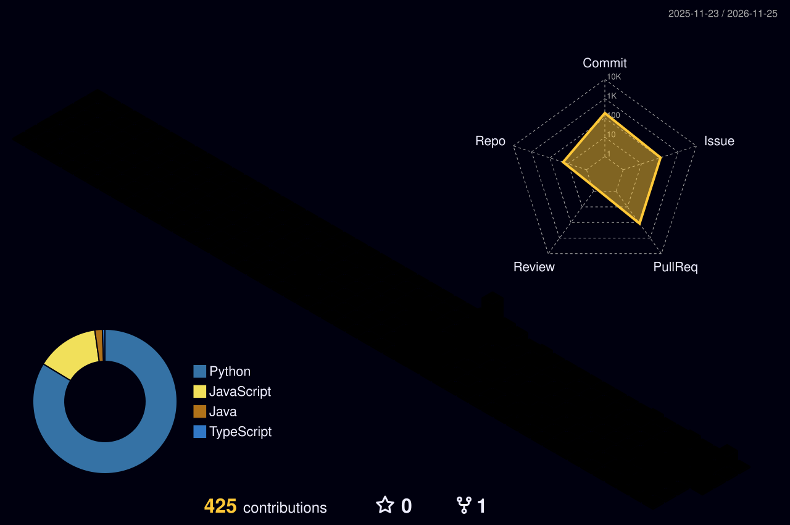

  

  
  
  
  

### About me

I'm a Computer Science student at Newton School of Technology in Bengaluru and a member of the openSUSE community.
I work on the tools other developers depend on, and my rule is simple: **ship small, ship often, and leave every codebase a little better than I found it.**

<!-- STATS:START -->
**425** contributions this year &nbsp;·&nbsp; **98** pull requests to other projects &nbsp;·&nbsp; best day **84** (11 Jul) &nbsp;·&nbsp; longest streak **18 days**
<!-- STATS:END -->

- **[checkstyle](https://github.com/checkstyle/checkstyle)**: regular contributor to the Java static-analysis tool, its [regression tooling](https://github.com/checkstyle/contribution) and its [OpenRewrite recipes](https://github.com/checkstyle/checkstyle-openrewrite-recipes)
- **openSUSE**: community member, invited participant at openSUSE.Asia Summit 2026 in Yogyakarta

### Featured project

<a href="https://github.com/sahityasingh08/PreFlight"><b>PreFlight</b></a> runs a GitHub organisation's CI on your machine, in Docker, so you push only when it passes.

  
  
  

Replayed across checkstyle, Flask, Express, axios, zustand and httpx · <a href="https://sahityasingh08.github.io/PreFlight/">live dashboard</a> · <a href="https://sahityasingh08.github.io/PreFlight/#guide">guide</a>

### Where my pull requests went

<!-- UPSTREAM:START -->
- [`SAPTARSHI-coder/EaseMotion-css`](https://github.com/SAPTARSHI-coder/EaseMotion-css/pulls?q=is%3Apr+author%3Asahityasingh08) &nbsp;39 PRs
- [`checkstyle/checkstyle`](https://github.com/checkstyle/checkstyle/pulls?q=is%3Apr+author%3Asahityasingh08) &nbsp;20 PRs
- [`dhairyagothi/100_days_100_web_project`](https://github.com/dhairyagothi/100_days_100_web_project/pulls?q=is%3Apr+author%3Asahityasingh08) &nbsp;15 PRs
- [`Aditya8369/Pollution-Control-Hub`](https://github.com/Aditya8369/Pollution-Control-Hub/pulls?q=is%3Apr+author%3Asahityasingh08) &nbsp;8 PRs
- [`ronisarkarexe/story-spark-ai`](https://github.com/ronisarkarexe/story-spark-ai/pulls?q=is%3Apr+author%3Asahityasingh08) &nbsp;6 PRs
- [`checkstyle/contribution`](https://github.com/checkstyle/contribution/pulls?q=is%3Apr+author%3Asahityasingh08) &nbsp;3 PRs
<!-- UPSTREAM:END -->

### My year in 3D

  

<picture>
  <source media="(prefers-color-scheme: dark)" srcset="assets/snake-dark.svg"/>
  
</picture>

### Tools I reach for

  

